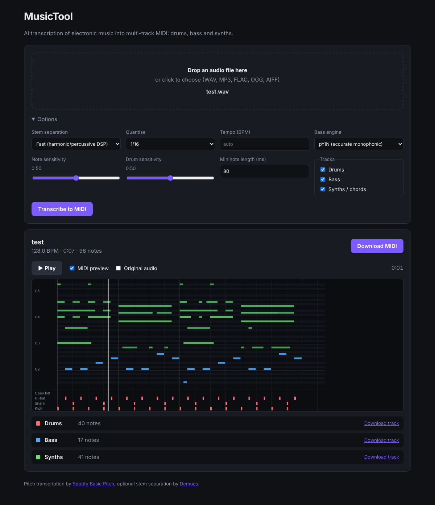

# MusicTool

AI transcription of **electronic music audio → multi-track MIDI**.
Drop in a track (WAV, MP3, FLAC, OGG, AIFF) and get a `.mid` file with a **Drums** track,
a **Bass** track and **one track per synth** (lead, pad, pluck, strings, ...), tempo-synced
and quantised to the grid, ready to drag into Ableton, FL Studio, Logic, Bitwig, and so on.



## How it works

With an NVIDIA GPU, every stage uses a neural network. Without one, MusicTool
falls back to fast CPU methods. **Auto**, the default, picks the best engine that is installed.

| Stage | GPU engine (default with NVIDIA) | CPU fallback |
|---|---|---|
| Stem separation | **Demucs v4 fine-tuned** (Meta), giving drums / bass / other / vocals stems | Harmonic/percussive separation + band split |
| Drums | **DrumSep** (MDX23C) splits the drum stem into kick / snare / toms / hi-hat / ride / crash, and onsets are detected on each piece. **ADTOF** (CNN + bi-GRU drum transcriber) then adds any hits DrumSep missed | Multi-band transient classifier |
| Bass | **YourMT3+** (PTF pitch-shift checkpoint) on the full mix, falling back to Basic Pitch on the bass stem when it hears no bass | pYIN |
| Synths / chords / leads | **Basic Pitch** notes from the "other" and vocal stems, split into instrument tracks with **YourMT3+** (MoE checkpoint) labels, plus the notes YourMT3+ hears that Basic Pitch misses. Notes below C3 (the bass's job) and quiet tails are dropped | Basic Pitch, one Synths track |
| Tempo | Beat tracking, then a beat-grid fit that also corrects 2:3 and 2:1 tempo errors | the same |
| Quantisation | Grid phase is taken from the drum hits; notes snap to 1/8, 1/16 or 1/32 | the same |

### Accuracy

`python bench/benchmark.py` renders a 30 s track with exactly known notes. It has a 909-style kick, snare
rolls, 16th-note and open hats, an acid bass with filter sweeps and glides, sidechained supersaw chords,
a delayed arpeggio lead, reverb and saturation. Each engine combination is then scored (mir_eval F1,
50 ms onset tolerance; 1.0 is perfect):

| Engines | kick | snare | hi-hat | bass | synths | mean |
|---|---|---|---|---|---|---|
| CPU fallback (DSP / DSP / pYIN) | 0.95 | 0.65 | 0.43 | 0.28 | 0.03 | 0.47 |
| Demucs + DrumSep/ADTOF + Basic Pitch | 0.96 | 0.94 | 0.92 | 0.84 | 0.38 | 0.81 |
| **+ YourMT3+ bass and instrument split (GPU default)** | 0.96 | 0.94 | 0.92 | 0.80 | 0.50 | **0.83** |

**Against a commercial transcription.** `python bench/reference.py reference.mid ours.mid ...`
scores output against a reference MIDI of the same track, after aligning tempo and offset.
Against a commercial service's transcription of an Aphex Twin track (F1, 60 ms):

| | kick | snare/clap | hi-hat | bass | synths |
|---|---|---|---|---|---|
| First version (CPU engines) | 0.78 | 0.69 | 0.42 | 0.19 | 0.13 |
| **GPU default** | 0.96 | 0.95 | 0.94 | 0.64 | ~0.25 |

Drums match the reference closely. Bass mostly agrees. Synths are the weak point. We find about a
third of the reference's synth notes, and add many it doesn't have (dense textures, delays, reverb).
YourMT3+ decoding on the GPU is not bit-exact, so synth scores vary by about ±0.03 between runs.
`python bench/compare_configs.py song.wav reference.mid` re-runs this comparison for each engine setting.

A 5-minute track takes about 3 minutes on an RTX 2070 Super. The models (~1.7 GB) live in
`%LOCALAPPDATA%\musictool\models`.

## Windows quick start

1. Install **Python 3.12** from <https://www.python.org/downloads/windows/>.
   In the installer, tick **"Add python.exe to PATH"**.
2. Download this repository (green **Code** button → **Download ZIP**) and unzip it.
3. Double-click **`install.bat`**. It sets everything up in a `.venv` folder.
   If it finds an NVIDIA GPU, it also installs PyTorch with CUDA and the neural models,
   a download of about 3.5 GB. Set `MUSICTOOL_CPU=1` beforehand to skip them.
4. Double-click **`start.bat`**. MusicTool opens in your browser. Close the
   black window, or press Ctrl+C in it, to stop the app.

You can also **drag audio files onto `transcribe.bat`**. It writes a `.mid` file,
plus one per track, next to each audio file without opening the browser.

If Windows SmartScreen warns about the `.bat` files, click *More info → Run anyway*.
They only create the `.venv` folder and install Python packages into it.

## Install (macOS / Linux / manual)

Requires Python 3.10+.

```bash
python -m venv .venv && source .venv/bin/activate
pip install --no-deps basic-pitch   # only its ONNX model is needed; avoids TensorFlow pins
pip install resampy mir_eval scikit-learn   # used by basic-pitch's inference code

# CPU only:
pip install -e ".[cpu]"

# or with an NVIDIA GPU: install CUDA PyTorch first, then pin it so nothing swaps in the CPU build
pip install torch torchaudio --index-url https://download.pytorch.org/whl/cu128
python -c "import torch, torchaudio; print(f'torch=={torch.__version__}\ntorchaudio=={torchaudio.__version__}')" > constraints.txt
pip install -e ".[gpu]" -c constraints.txt --extra-index-url https://download.pytorch.org/whl/cu128
```

Pick one of `cpu` or `gpu`: `onnxruntime` and `onnxruntime-gpu` overwrite each other.

## Use it

**Web app**

```bash
musictool serve --open     # http://127.0.0.1:8000
```

Upload a file, tweak the options, and watch progress. You can then preview the
result on a piano roll, play the MIDI back with a built-in synth (alongside the
original audio if you like), and download the full MIDI or individual tracks.

**Command line**

```bash
musictool track.mp3                       # writes track.mid
musictool track.wav -o out.mid --separate-tracks   # also out_drums.mid, out_bass.mid, ...
musictool track.wav --save-stems          # also writes the separated stems as .wav
musictool track.wav --separation demucs --quantize 32 --bpm 174
musictool track.wav --separation hpss --drum-engine dsp --mono-engine pyin   # CPU engines
musictool --help
```

**Python**

```python
from musictool import transcribe, TranscriptionOptions

result = transcribe("track.wav", TranscriptionOptions(quantize=16))
print(result.bpm, [(t.name, len(t.notes)) for t in result.tracks])
result.write("track.mid")
```

## Tips

* Is there too much noise in the synth track? Lower the *Note sensitivity* or raise `--onset-threshold`.
* Are hats or percussion missing? Raise *Drum sensitivity*.
* Tempo is read in the 85–180 BPM range. Drum & bass often comes out half-time (87 instead of 174),
  so set `--bpm` explicitly for it.
* The **Separated audio stems** links in the web app, or `--save-stems`, give you the Demucs stems to use in your DAW.

## Tests

```bash
pip install -e '.[dev]'
pytest
```

The tests render a synthetic electronic track with known kick, snare, hat,
bass and chord notes. They check tempo, per-instrument accuracy, the MIDI
output, the CLI and the web API. `tests/test_neural.py` covers the GPU engines
and is skipped when they aren't installed.
